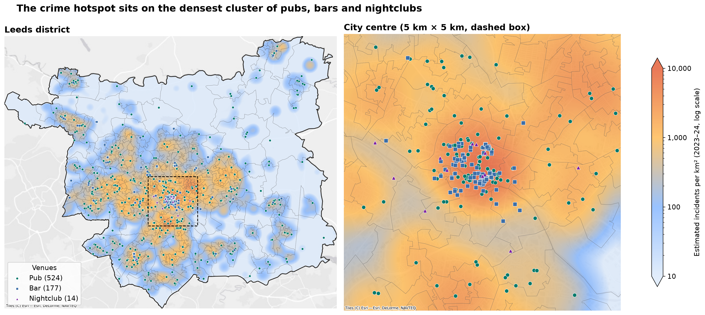
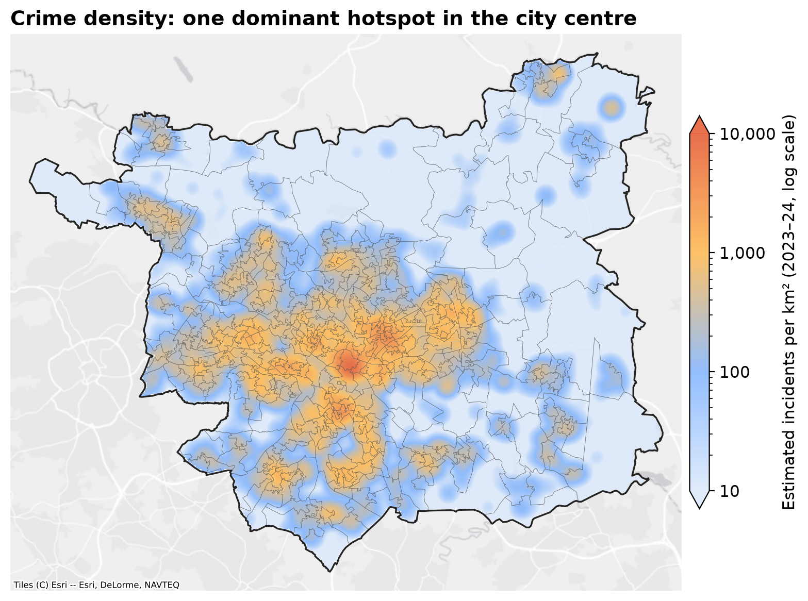
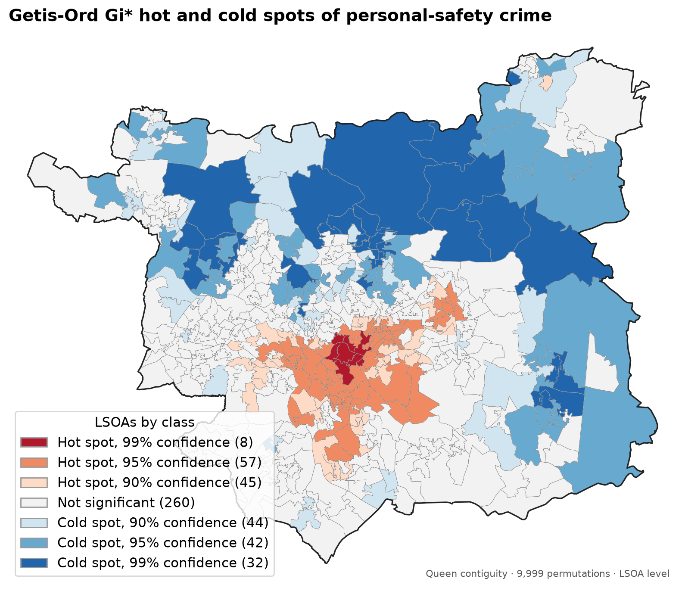
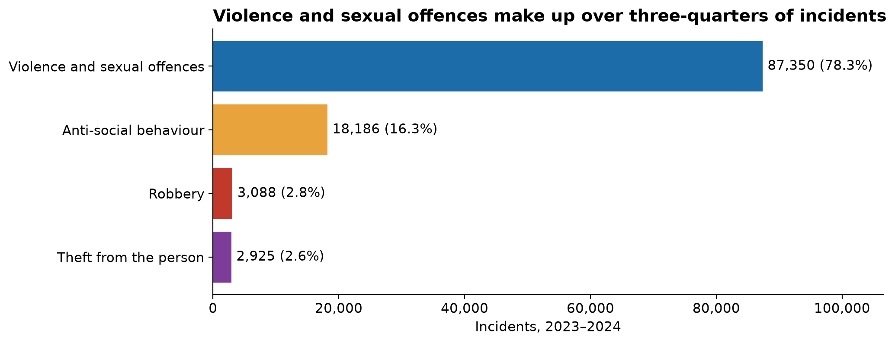
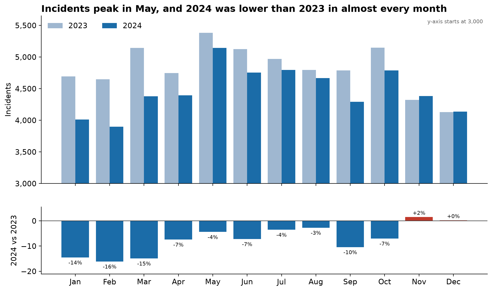
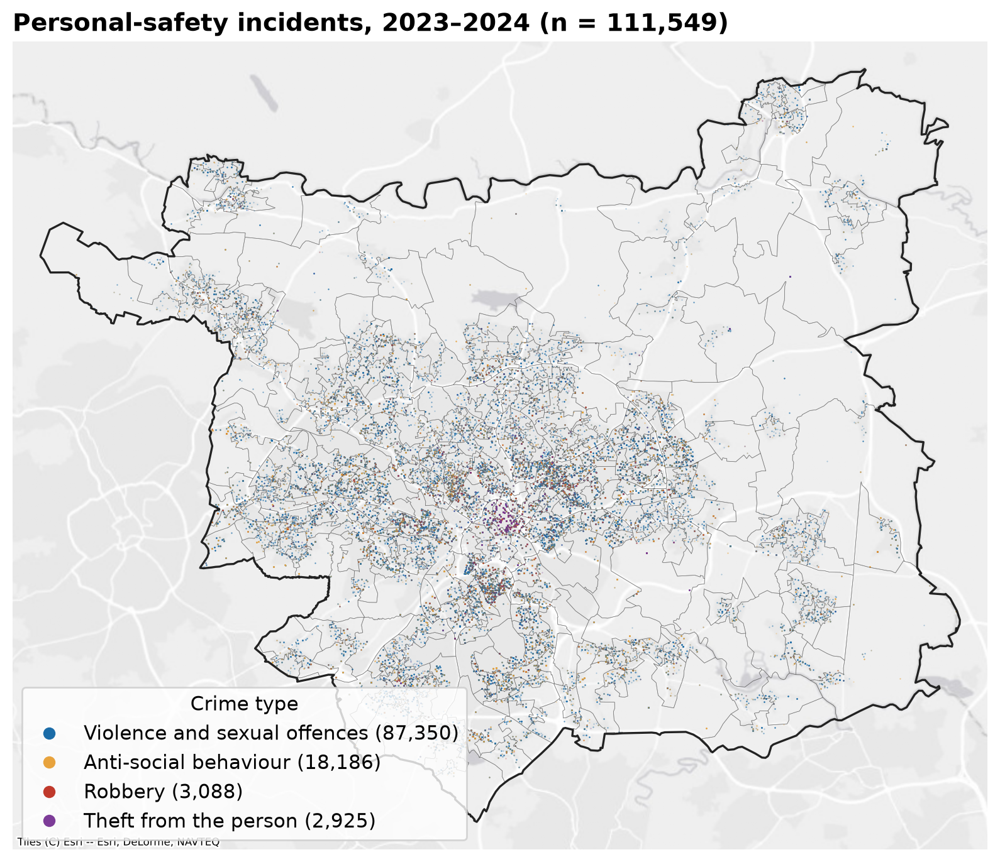
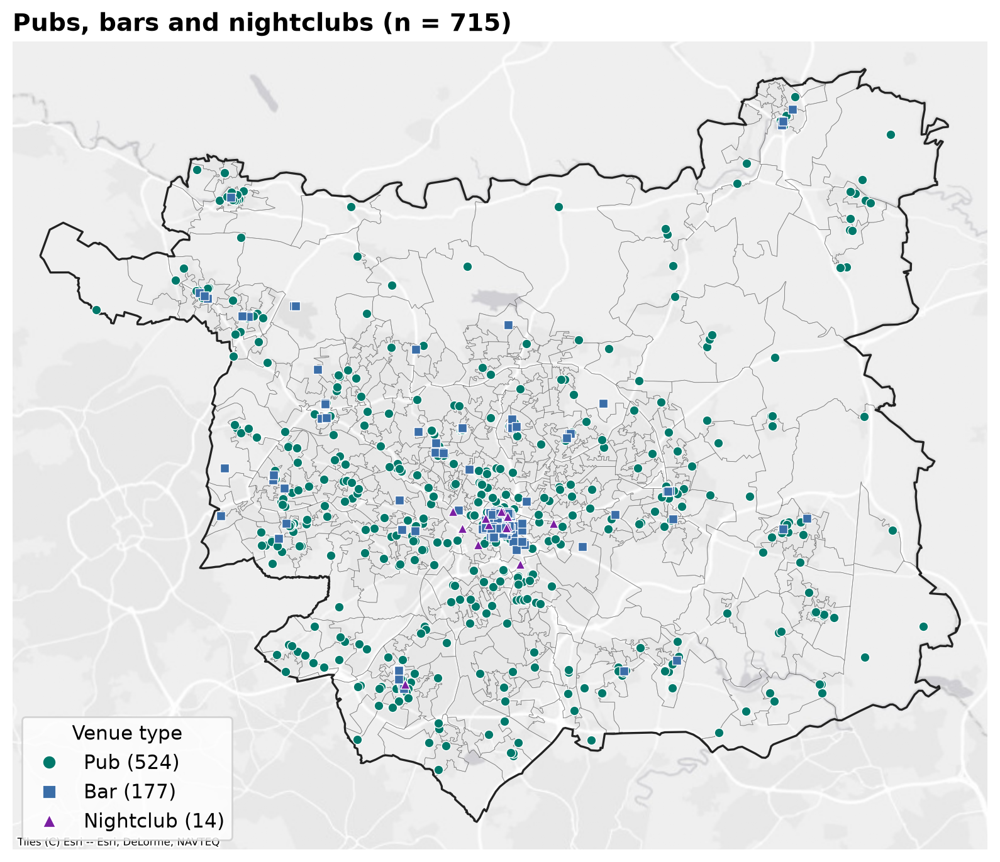
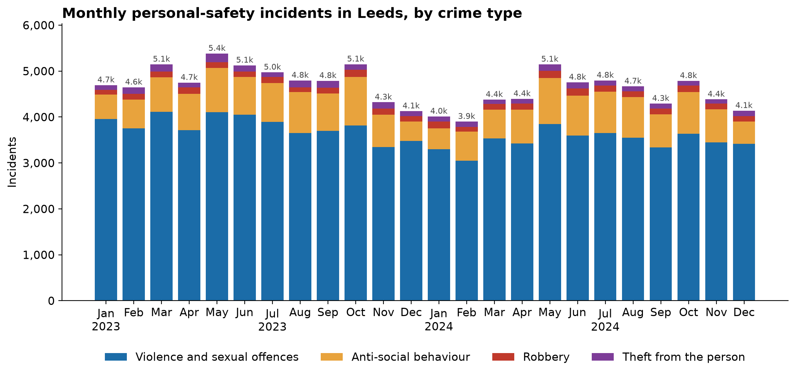

# Crime Hotspots and Nightlife in Leeds

**Do crime clusters in Leeds line up with pubs, bars and nightclubs?**

**Short answer: yes, in the city centre.** Leeds has one dominant, statistically significant hotspot of personal-safety crime. It sits on the densest cluster of nightlife venues, and violence makes up 78% of the incidents. Away from the centre, though, an area's number of venues barely predicts its crime level.

This is a geospatial analysis of **111,549 police records** (2023–2024) and **715 venue locations**, built entirely from free public data in Python.



---

## Why this matters

Police forces have limited officers to cover a large city. Between August 2023 and July 2024, West Yorkshire Police recorded 105,021 offences in Leeds, 37,250 of them violent ([West Yorkshire Combined Authority, 2024](https://www.westyorks-ca.gov.uk/media/zbjltajx/west-yorkshire-policing-and-crime-annual-report-2023-24.pdf)). If you know exactly where risk is concentrated, you can patrol those places proactively instead of reacting after incidents.

- **Business question:** Where should police focus their resources to have the biggest impact on public safety in Leeds?
- **Analytical question:** Do crime hotspots in Leeds coincide with concentrations of pubs, bars and nightclubs, and does the pattern change over the year?

## Key findings

| | Finding |
|---|---|
| 🎯 | **One dominant hotspot.** Crime density peaks at about 9,600 incidents per km² in the city centre, against a Leeds median of 31. |
| 🍺 | **The hotspot overlaps the nightlife.** The densest 10% of Leeds holds **65% of incidents** and **52% of venues**. It overlaps the densest venue area **3.9×** more than chance would give. |
| 📊 | **It's statistically significant.** Getis-Ord Gi\* flags 65 hot-spot LSOAs at 95%+ confidence. They cover **6% of Leeds** but contain **30% of incidents** and **34% of venues**. The four city-centre LSOAs stay significant after correcting for multiple testing. |
| ⚖️ | **But it's a city-centre effect.** Across all 488 LSOAs, the link between venue count and crime is weak (Spearman ρ = 0.15). LSOAs with 6+ venues average 792 incidents against 196 for LSOAs with none, driven by the centre. |
| 👊 | **Violence drives the risk.** Violence and sexual offences make up **78.3%** of incidents. |
| 📅 | **Crime is seasonal and falling.** Incidents peak in May in both years. 2024 was **7.3% lower** than 2023, with January to March down about 15%. |

## Data

| Source | What | Coverage |
|---|---|---|
| [data.police.uk](https://data.police.uk) | Street-level crime records, West Yorkshire Police | Jan 2023 – Dec 2024 (24 monthly files, 642,403 records) |
| [OpenStreetMap](https://www.openstreetmap.org) via the Overpass API | Pubs, bars and nightclubs in Leeds | 715 venues |
| [ONS Open Geography Portal](https://geoportal.statistics.gov.uk) | LSOA 2021 boundaries (small census areas) | 488 Leeds LSOAs |

Download steps and licence details are in [data/README.md](data/README.md).

## Approach

| Notebook | Steps |
|---|---|
| [01 · Data preparation](notebooks/01_data_preparation.ipynb) | Merge the 24 monthly files (642,403) → remove records with no location (633,965) → keep Leeds LSOAs (230,463) → keep the four personal-safety crime types (**111,549**). Load the 715 venues. |
| [02 · Hotspot mapping](notebooks/02_hotspot_mapping.ipynb) | Point maps → **Kernel Density Estimation** (300 m bandwidth, 100 m grid, in incidents per km²) → venue overlay → overlap between crime and venue hotspot areas → interactive map |
| [03 · Hotspot significance](notebooks/03_hotspot_significance.ipynb) | Count incidents and venues per LSOA → **Getis-Ord Gi\*** (Queen contiguity, 9,999 permutations, FDR correction) → hot/cold spot map → Spearman correlation between venues and crime |
| [04 · Temporal patterns](notebooks/04_temporal_patterns.ipynb) | Crime-type breakdown → monthly trend → 2023 vs 2024 month-by-month comparison |

**Design choices:**
- **Leeds filter:** filtering by LSOA name (`Leeds 111B`, …) gives an exact administrative boundary. Clipping by a bounding box would let in records from Bradford, Kirklees and Calderdale.
- **Crime types:** the four types kept (violence and sexual offences, anti-social behaviour, robbery, theft from the person) are the ones that threaten people directly. Property crime is excluded.
- **Units and scale:** distances are computed in British National Grid (metres). Density maps use a log colour scale because density varies a thousandfold across the district.

## Results

### 1. One dominant hotspot, on top of the nightlife district



The crime surface has one clear peak in the city centre, with secondary concentrations in inner suburbs to the east, west and south. The overlay at the top of this page shows that pubs, bars and nightclubs are packed into the same core. The zoomed panel shows the density peak sitting directly under the bar and nightclub cluster.

| Overlap measure | Value |
|---|---:|
| Incidents inside the densest 10% of Leeds | 64.8% |
| Venues inside the same area | 52.4% |
| Share of that area that is also among the densest 10% for venues | 39.5% (3.9× chance) |

### 2. The hotspot is statistically significant



| Group of LSOAs | Share of Leeds area | Share of incidents | Share of venues |
|---|---:|---:|---:|
| Hot spots at 95%+ confidence (65 LSOAs) | 6.1% | 30.3% | 34.0% |

The strongest hot spot is **Leeds 111B**, the commercial core, with **6,160 incidents** (5.5% of the Leeds total in one small area) and 96 venues. Six LSOAs stay significant after a false discovery rate correction: all four city-centre LSOAs (111A, 111B, 111C, 111E) and two inner-city neighbours. Significant cold spots cover the rural north and east.

### 3. The link is concentrated in the centre

| Venues in the LSOA | LSOAs | Median incidents | Mean incidents |
|---|---:|---:|---:|
| 0 | 228 | 166 | 196 |
| 1–2 | 202 | 150 | 206 |
| 3–5 | 40 | 224 | 276 |
| 6+ | 18 | 286 | 792 |

Crime rises with venue numbers only at the top end. Across all LSOAs the rank correlation is weak (ρ = 0.15, p < 0.001). The "nightlife effect" belongs to the dense city-centre cluster, not to every neighbourhood with a pub.

### 4. Violence drives the risk



### 5. Crime peaks in late spring and fell in 2024



<details>
<summary><b>More figures</b></summary>

**Crime points (n = 111,549)**


**Venue points (n = 715: 524 pubs, 177 bars, 14 nightclubs)**


**Monthly incidents by crime type**


</details>

There's also an **interactive map** of crime density, venues and LSOA boundaries: [results/maps/leeds_crime_venues_map.html](results/maps/leeds_crime_venues_map.html). Download it and open it in a browser.

## Recommendations

1. **Put patrol resources in the city-centre hot spot first**, specifically LSOAs 111A, 111B, 111C and 111E, which stay significant even after the strictest test. Together they hold about 9% of all incidents.
2. **Focus on violence prevention there**, since violence and sexual offences account for most of the risk. This could mean working with venue licensing, door staff and late-night transport.
3. **Don't treat every pub as a risk.** Outside the centre, venue numbers barely predict crime, so blanket policies on suburban venues would be poorly targeted.
4. **Scale up from spring into summer**, when incidents consistently peak.
5. **Re-run the analysis each year.** It uses only free public data, and the pipeline runs from raw files to figures in a few minutes.

## Limitations

- **No time of day.** Police data is published by month, so I couldn't confirm that incidents happen during nightlife hours.
- **Correlation, not causation.** The city centre also has the most people, shops and transport hubs. Crime rates based on resident population understate how many people are actually present there ([Malleson & Andresen, 2015](https://doi.org/10.1186/s40163-015-0023-8)), and footfall data would be needed to separate the venues' effect from the crowds'.
- **Approximate locations.** For privacy, data.police.uk moves each incident to the nearest of a fixed set of anonymous map points. The 300 m KDE bandwidth smooths over this, but fine-scale patterns (individual streets) shouldn't be over-read. About 4% of incidents also sit just across an LSOA boundary from their recorded LSOA.
- **OSM completeness.** Venue data is crowd-sourced and may miss or misclassify some venues.

## Next steps

- **Buffer analysis:** measure the share of incidents within a short distance of each venue. Research in Philadelphia found that violence around bars is concentrated within about 26 m ([Ratcliffe, 2012](https://doi.org/10.1111/j.1538-4632.2012.00856.x)), but the anonymised police locations would limit how fine this can go.
- **Regression model:** estimate the effect of venue density at LSOA level while controlling for population, footfall and transport hubs.
- **Baseline comparison:** check whether crime unrelated to nightlife (e.g. burglary) shows the same hotspot. If it does, the pattern reflects city-centre activity in general.

## Skills demonstrated

**Data engineering**
- Merging and cleaning a 640k-record, multi-file dataset
- Collecting data from a REST API (OpenStreetMap Overpass)
- Spatial joins and filtering with census geographies (LSOAs)
- Turning exploratory Colab scripts into a reproducible pipeline (shared `src/` package with numbered notebooks)

**Geospatial and statistical analysis**
- Kernel Density Estimation with real-world units
- Hotspot detection with Getis-Ord Gi\*, permutation inference and FDR correction
- Testing an association quantitatively (overlap vs chance, rank correlation)
- Time-series and seasonal analysis

**Communication**
- Map and chart design with consistent styling
- Turning analysis into targeted recommendations
- Reporting where the evidence is weak as well as where it's strong

## Tools

Python · pandas · GeoPandas · Shapely · scikit-learn · PySAL (libpysal, esda) · SciPy · Matplotlib · contextily · Folium · Jupyter · OpenStreetMap Overpass API

## Repository structure

```
├── data/
│   ├── README.md        # sources, licences, download steps
│   ├── raw/             # source files (not committed)
│   └── processed/       # cleaned outputs created by notebook 01 (not committed)
├── notebooks/
│   ├── 01_data_preparation.ipynb
│   ├── 02_hotspot_mapping.ipynb
│   ├── 03_hotspot_significance.ipynb
│   └── 04_temporal_patterns.ipynb
├── src/
│   ├── config.py        # paths, crime types, CRS and analysis parameters
│   ├── data.py          # load, clean and filter crime records; load or download venues
│   ├── geo.py           # boundaries, points, kernel density, overlap measures
│   ├── stats.py         # counts per LSOA, Getis-Ord Gi*
│   └── plotting.py      # shared map and chart styling
├── results/
│   ├── figures/         # every chart and map in this README
│   ├── tables/          # summary tables behind the numbers above
│   └── maps/            # interactive HTML map
└── requirements.txt
```

## How to reproduce

```bash
git clone https://github.com/<your-username>/leeds-crime-analysis.git
cd leeds-crime-analysis
python -m venv .venv
.venv\Scripts\activate          # macOS/Linux: source .venv/bin/activate
pip install -r requirements.txt
```

1. Download the data into `data/raw/` as described in [data/README.md](data/README.md).
2. Run the notebooks in order (01 → 04) in Jupyter or VS Code, or all at once:

```bash
jupyter nbconvert --to notebook --execute --inplace notebooks/*.ipynb
```

Every figure in `results/figures/` and every table in `results/tables/` is regenerated from the raw data. A full run takes a few minutes.

---

*Crime data: © Crown copyright, Open Government Licence v3.0. Venue data: © OpenStreetMap contributors, ODbL. Boundaries: Office for National Statistics, Open Government Licence v3.0. Basemap tiles: © Esri.*
